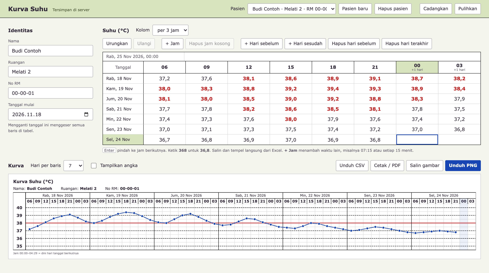
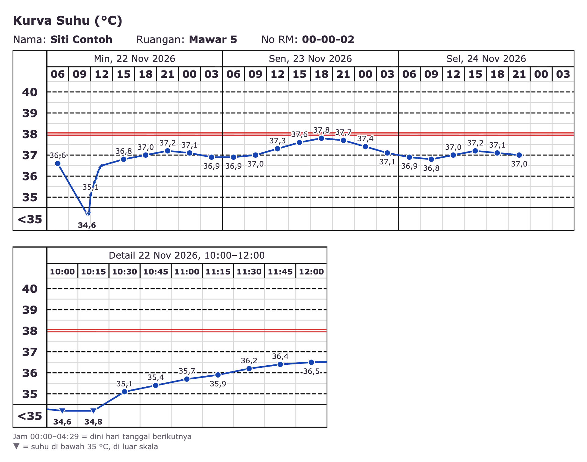
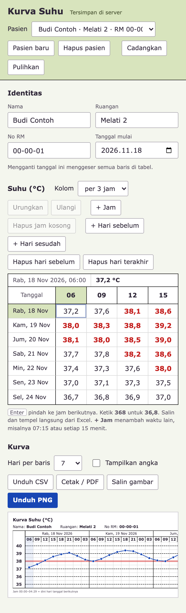

# Kurva Suhu

Patient temperature log with a spreadsheet and a printable temperature chart. The interface
is in Indonesian.



The patients in these screenshots are invented.

## Features

- **Spreadsheet entry.** One row per ward day, with columns at 06, 09, 12, 15, 18, 22 and 02
  or every hour.
  Type `368` for 36.8, press Enter for the next time, paste from Excel, undo and redo.
- **Any time.** **+ Jam** adds columns for other times, for example 07:15 or every 15 minutes.
- **Chart like the paper form.** Red double line at 38 °C, fever in red in the table. Readings
  below 35 °C get their own band, and readings taken close together get an enlarged strip.
- **Mistakes stay visible.** A mistyped value is marked in the table and left off the chart.
- **Export.** PNG, print or PDF (A4 landscape), CSV, or copy the image. Copying needs HTTPS,
  localhost, or the file version.
- **Several devices.** Patients are shared through the server. Edits to the same patient are
  merged cell by cell.
- **No dependencies and no build step.** Plain HTML, CSS, and JavaScript, and one Node.js file.

| Exported chart | On a phone |
| --- | --- |
|  |  |

## Run on a server with Docker

Needs Docker with the Compose plugin. Clone this repository on the server, then in its folder:

```bash
cp .env.example .env
```

Set `APP_PASSWORD` in `.env`, then:

```bash
docker compose up -d --build
```

Open `http://<server-ip>:8080` from any device on the network. The browser asks for a
user name (anything) and the password. If a firewall is on, allow the port, for example
`sudo ufw allow from 192.168.0.0/16 to any port 8080 proto tcp`.

Traffic is plain HTTP, so the password and patient data are readable to anyone who can
capture traffic on the network. Do not expose the port to the internet; put it behind an
HTTPS reverse proxy or a VPN for that.

### Data

Patients are stored on the server in the Docker volume `temp-curve-data`, one JSON file
each, unencrypted. They survive restarts and rebuilds. `docker compose down -v` deletes them.

Back up:

```bash
docker run --rm -v temp-curve-data:/data -v "$PWD":/backup alpine tar czf /backup/temp-curve-backup.tar.gz -C /data .
```

**Cadangkan** and **Pulihkan** in the app save and load all patients as one file. Restoring
only adds what is missing and never overwrites. Use them to move data from the file
version to the server.

Backups and exports contain patient data. `.gitignore` covers their default names; do not
commit them under another name.

### Update

Run `git pull`, then `docker compose up -d --build` again.

## Run on a server without Docker

Needs Node.js. The Docker image uses version 24.

```bash
APP_PASSWORD=choose-a-password node server/server.js
```

Patients are stored in `data/` in this folder. Set `DATA_DIR` and `PORT` to change the folder
and the port. Without `APP_PASSWORD` anyone on the network can read and change the data.

## Run without a server

Open `index.html` in a browser. Data then stays in that browser only.

## Files

| Path | Contents |
| --- | --- |
| `index.html`, `style.css` | The page |
| `js/model.js` | Patients, temperatures, dates, merging |
| `js/grid.js` | The spreadsheet |
| `js/chart.js` | The chart, drawn as SVG |
| `js/store.js` | Saving to the server or the browser |
| `js/app.js` | Connects the parts; exports and backup |
| `server/server.js` | Serves the page and stores patients |
